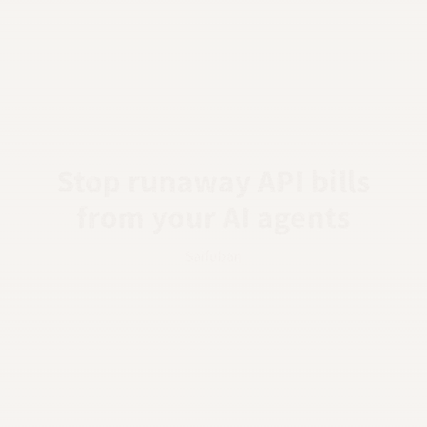

# AIの財布番 (Saifuban) — a spending guard for AI agents

**AIがお金を使う前に、あなたのスマホに承認を聞きにくる。AIエージェントのAPI代も1日の予算で止める。Claude・ChatGPT・Museで使えて、Museならチャットに1通送るだけ。日本語・円対応。**
**Hard daily caps on your AI agents' API spend, plus phone approval before any other payment.**

👉 https://ut181749ut.github.io/saifuban/


---

## 日本語

AIエージェントは支払いの前に財布番に「払っていいか」を聞きます。財布番はあなたが決めたルールで答えます。

- 少額(例: 300円以下)は自動で許可
- それを超えるとスマホに通知 → 承認 / 却下をワンタップ
- 1日・1週間・1か月の予算、1回の上限、支払先の制限
- 「聞かずに払う」のを、前に払ったことがある支払先だけにする設定(初めての支払先はスマホで確認)
- 緊急停止ボタン
- AIごとに別々のルール
- サブスク(定期購入)は金額に関係なく必ずスマホで確認。通知に年額を表示。AIが申告し忘れても、理由や支払先の文言から定期購入らしいものを見つけて確認に回す
- AIが自分の過去の申請を調べられる(同じ支払いを二重にしないため)
- APIキーを預ければ、AIエージェントのAPI代も1日・週・月の予算で強制停止(AIには代理のキーだけを渡す)
- 日本語・円で使える。メール登録なし・無料

財布番はお金を動かしません。カード情報や口座は預かりません。

### 使い方

1. サイトで「はじめる」→ 予算を選ぶ → AI用のURLが出る
2. そのURLをAIに登録(Claude: コネクタ / ChatGPT: 開発者モードのアプリ / Muse: チャットでURLを送る / Cursor・VS Code: MCP設定)

URLをコピーせずにつなぐこともできます(OAuth)。ClaudeやChatGPTのコネクタに次のURLを登録すると財布番の許可画面が開くので、つなぐAIを選んで「許可する」を押すだけです。

```
https://zrphnuvrsldcycxtdftv.supabase.co/functions/v1/saifuban-mcp
```
3. AIに「財布番で今日の残り予算を見て」と聞いて確認

## English

**Stop your AI agents from overspending.** Saifuban puts a hard daily cap on your agents' API bills and makes them ask your phone before any other payment.



### Hard cap on API bills

Store your OpenAI, Anthropic, Google or OpenRouter key in Saifuban. Your agent only gets a proxy key (`sbk_...`), every call is metered, and requests are refused once the agent's daily (or optional weekly/monthly) budget is reached. Your real key never reaches the agent.

### Phone approval for everything else


Your AI agent asks Saifuban before every payment. Saifuban answers using your rules.

- Auto-approve small amounts (e.g. under ¥300)
- Anything above goes to your phone as a push notification — approve or reject in one tap
- Daily, weekly and monthly budgets, per-transaction limit, allowed merchants
- Optional: auto-approve only merchants you've paid before; new merchants always go to your phone
- Kill switch
- Separate rules per agent

Saifuban never moves money and never stores card or bank details. It only decides whether a payment is allowed.

### Setup

1. Open the site, press "はじめる" (Start), pick a budget — you get a personal MCP URL
2. Add the URL to your AI as a remote MCP server (Streamable HTTP, no auth — the key is in the URL). With Muse, just send the URL in a chat message and ask it to connect

Or skip the copy-paste and connect with OAuth: add `https://zrphnuvrsldcycxtdftv.supabase.co/functions/v1/saifuban-mcp` as a connector in Claude or ChatGPT. A Saifuban consent page opens; pick (or create) the agent and press Allow. Dynamic Client Registration and PKCE (S256) are supported.
3. Ask your AI: "Check my remaining budget with Saifuban"

## MCP tools

| Tool | What it does |
|---|---|
| `request_payment` | Ask whether a payment (`merchant`, `amount`, `currency` JPY/USD, `reason`, `recurring` none/week/month/year) is allowed. Waits up to 45 s for phone approval. Returns a single-use `payment_token` when approved. Subscriptions always need your approval, whatever the amount, and the notification shows the yearly cost. Retrying a request that is still pending returns the same request instead of creating a new one (or pass `idempotency_key`). |
| `check_payment_status` | Check whether a pending request was approved. |
| `list_payments` | The agent's own past requests (filter by merchant / days), so it can check e.g. whether a Spotify charge was already approved this month and avoid paying twice. |
| `get_budget` | Remaining budget today, this week and this month, per-transaction limit, auto-approve threshold, allowed merchants. |

Endpoint: `https://zrphnuvrsldcycxtdftv.supabase.co/functions/v1/saifuban-mcp/<your-key>` (get your key on the site)

## Hard enforcement: single-use payment tokens

Calling `request_payment` is voluntary, so a prompt-injected agent could simply skip it. To make the guard enforceable, every **approved** request comes with a `payment_token` (`sbt_...`):

- single-use, valid for 24 hours
- bound to the approved merchant and amount
- invalid if the AI is stopped or the kill switch is on

Whatever actually moves the money (your payment tool, wrapper, or merchant backend) should require this token and redeem it before paying:

```bash
curl -X POST https://zrphnuvrsldcycxtdftv.supabase.co/functions/v1/saifuban/redeem \
  -H "content-type: application/json" \
  -d '{"token":"sbt_...","merchant":"OpenAI","amount":12.5,"currency":"USD"}'
# => {"valid":true,"consumed":true,...}  or  {"valid":false,"error":"already_used" | "merchant_mismatch" | "amount_exceeds_approval" | ...}
```

`/verify` takes the same body and checks without consuming. No agent key is needed to redeem, so the payment side doesn't have to share secrets with the agent.

API spend is already hard-enforced: when you store your provider API key in Saifuban, the agent only ever gets a proxy key.

## Links

- [利用規約 / Terms](https://ut181749ut.github.io/saifuban/terms.html)
- [プライバシーポリシー / Privacy](https://ut181749ut.github.io/saifuban/privacy.html)
- Issues / requests: https://github.com/ut181749ut/saifuban/issues
